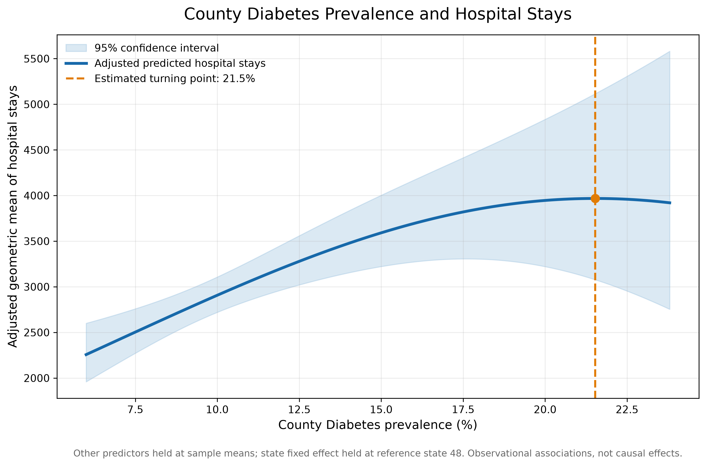
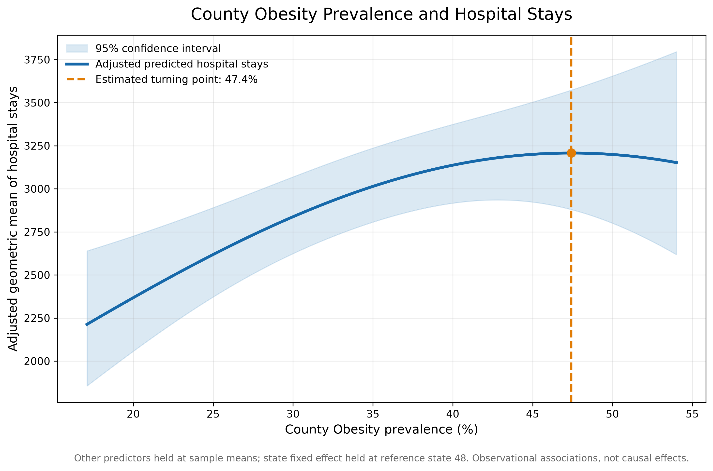

## Overview

Chronic diseases such as diabetes and obesity contribute substantially to the
healthcare needs of communities. Understanding how county-level disease
prevalence relates to hospital utilization can help identify geographic
patterns and inform further investigation into population health and
healthcare delivery.

This analysis examines the relationship between county diabetes prevalence,
county obesity prevalence, and hospital stays. It uses quadratic regression
models to investigate whether these relationships are nonlinear after
adjusting for selected socioeconomic and healthcare-access characteristics.

::: {.callout-note}
**Key takeaway**

Both adjusted relationships increase across much of the observed prevalence
range and then flatten. The estimated quadratic terms are suggestive but do
not meet the conventional 0.05 statistical significance threshold. The
estimated turning points should therefore be treated as exploratory, not as
established thresholds.
:::

## Research questions

1. How is county diabetes prevalence associated with adjusted hospital stays?
2. How is county obesity prevalence associated with adjusted hospital stays?
3. Do these relationships exhibit evidence of nonlinear patterns after
   accounting for other county characteristics and state-level differences?

## Data and study population

The analysis uses a county-level analytic dataset:

`analytic_supplement_20260325[1].csv`

The analytic sample includes **2,684 counties** across **48 state clusters**.

The variables used were:

| Measure | Role in analysis |
|---|---|
| Hospital stays | Outcome |
| Diabetes prevalence | Primary predictor |
| Obesity prevalence | Primary predictor |
| Primary care access | Adjustment variable |
| Uninsured prevalence | Adjustment variable |
| Unemployment | Adjustment variable |
| State | Fixed effect and clustering variable |

Counties were retained when state and county codes were positive, hospital
stays and primary care access were positive, and the model variables were
available.

The original publisher, collection year, and detailed variable definitions
should be confirmed against the source documentation before this analysis is
used for external policy or clinical conclusions.

## Statistical methods

### Model specification

Ordinary least squares regression was used with the natural logarithm of
hospital stays as the outcome.

The model included:

- Log-transformed primary care access.
- Centered diabetes prevalence and its squared term.
- Centered obesity prevalence and its squared term.
- Centered uninsured prevalence.
- Centered unemployment.
- State fixed effects.

Standard errors were clustered by state to account for potential
within-state correlation among county observations.

The model's R-squared was **0.351**.

### Adjusted predictions

Adjusted predictions were generated across the observed range of each
prevalence measure. Other predictors were held at their sample means, and
the state fixed effect was held at the most frequently observed state
(reference state code 48).

The shaded regions represent 95% confidence intervals for the adjusted
mean predictions. These are not prediction intervals for individual counties.

### Turning points

For each quadratic relationship, the estimated turning point was calculated
from the linear and quadratic coefficients:

\[
x^* = -\frac{\beta_1}{2\beta_2}
\]

The resulting estimates describe the location of the fitted curve's maximum
when the quadratic coefficient is negative. They do not, by themselves,
demonstrate that a meaningful threshold exists in the underlying population.

## Results

### Diabetes prevalence

{fig-alt="Adjusted predicted hospital stays increase with county diabetes prevalence and flatten near the estimated turning point."}

The estimated turning point was **21.53% diabetes prevalence**.

The quadratic-term p-value was **0.0671**.

The adjusted curve rises across much of the observed diabetes prevalence
range before flattening near the estimated turning point. A slight decline
appears beyond that point.

However, the quadratic term does not meet the conventional 0.05
statistical significance threshold. The estimated turning point should
therefore be interpreted cautiously.

### Obesity prevalence

{fig-alt="Adjusted predicted hospital stays increase with county obesity prevalence and flatten near the estimated turning point."}

The estimated turning point was **47.43% obesity prevalence**.

The quadratic-term p-value was **0.0582**.

The adjusted curve rises across much of the observed obesity prevalence
range and begins to flatten near the estimated turning point. A slight
decline appears at the highest prevalence levels.

The quadratic term approaches, but does not reach, conventional statistical
significance. The estimated turning point is exploratory rather than
conclusive.

## Summary of findings

| Analysis measure | Diabetes | Obesity |
|---|---:|---:|
| Estimated turning point | 21.53% | 47.43% |
| Quadratic-term p-value | 0.0671 | 0.0582 |
| Meets 0.05 significance threshold? | No | No |

The model included 2,684 county observations, 48 state clusters, and had
an R-squared of 0.351.

Taken together, the findings suggest that county-level diabetes and obesity
prevalence may have nonlinear relationships with hospital utilization.
However, neither quadratic term achieved conventional statistical
significance.

## Interpretation and implications

The results are consistent with a positive association between chronic
disease prevalence and adjusted hospital utilization across much of the
observed range. The flattening of the fitted curves raises questions about
whether the relationship changes at higher levels of prevalence.

Several explanations could account for these patterns, including differences
in healthcare access, disease management, population characteristics, and
the distribution of other county-level factors. This analysis does not
distinguish among those explanations.

The results should not be interpreted as evidence that increasing diabetes
or obesity prevalence reduces hospital utilization beyond the estimated
turning points.

## Limitations

1. **Observational design:** The analysis identifies associations and cannot
   establish causal effects.
2. **Ecological analysis:** County-level relationships cannot be assumed to
   represent individual-level relationships.
3. **Residual confounding:** Adjustment for the included variables and state
   fixed effects does not eliminate all potential confounding.
4. **Uncertain turning points:** Neither quadratic term achieved the
   conventional 0.05 significance threshold.
5. **Uncertainty at the extremes:** Confidence intervals widen substantially
   at higher prevalence levels, indicating less precise estimates.
6. **Data provenance:** The original dataset publisher, collection year, and
   full measure definitions require confirmation from the source
   documentation.
7. **Model specification:** Results may be sensitive to the functional form,
   included covariates, and treatment of geographic clustering.

## Conclusion

County-level diabetes and obesity prevalence show suggestive nonlinear
relationships with adjusted hospital utilization. Both fitted curves
increase across much of the observed prevalence range before flattening.
Estimated turning points were 21.53% for diabetes and 47.43% for obesity,
but neither quadratic term was statistically significant at the 0.05 level.

These findings are best viewed as exploratory evidence that warrants
additional investigation. Longitudinal data, alternative model
specifications, and more detailed measures of healthcare access could help
determine whether these patterns are robust.

## Reproducibility

The analysis was conducted in Python using:

- pandas for data preparation.
- NumPy for numerical calculations.
- statsmodels for regression modeling and clustered standard errors.
- Patsy for model design matrices.
- Matplotlib for visualization.

The analysis script is maintained in the project repository as
`plot_adjusted_relationships.py`.

The figures shown above were generated from the fitted model and saved
as PNG files in the project's research figures directory.

---

*This analysis is intended for research and educational purposes. Findings
are observational and should not be interpreted as causal effects or
clinical guidance.*
